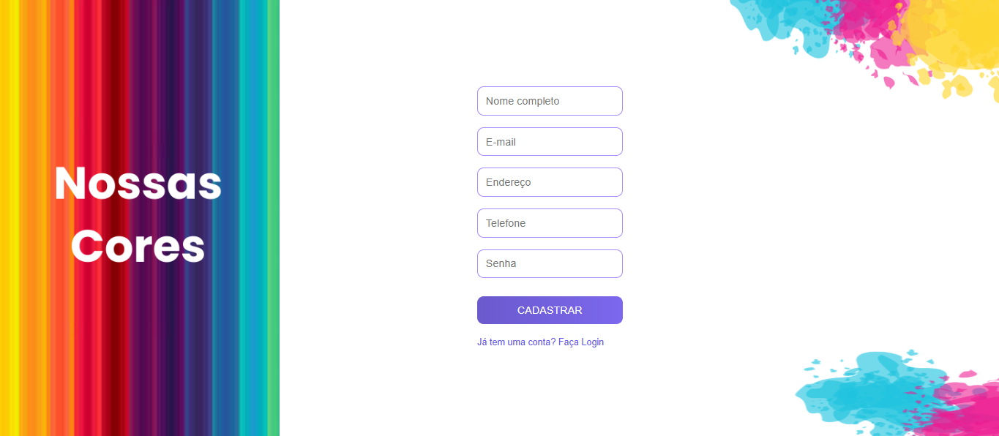
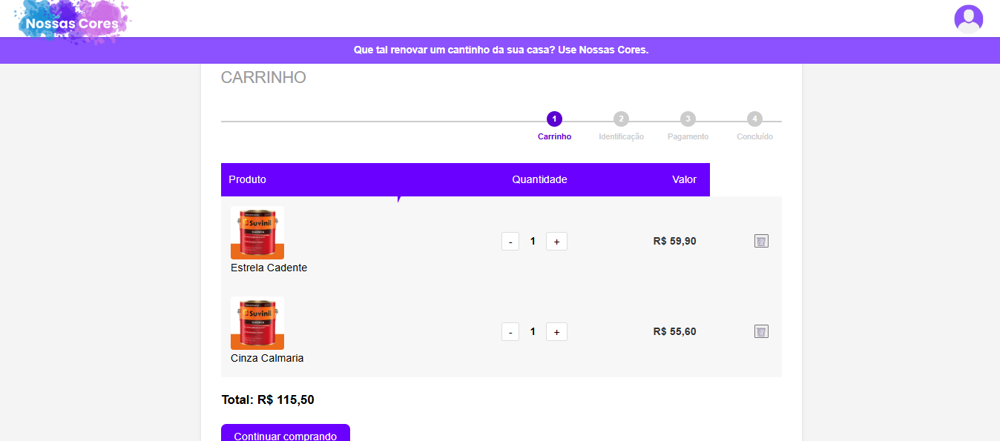

# NossasCores

<p align="center">
  
</p>

<p align="center">
  Aplicação web para catálogo e comercialização de tintas, com categorias de acabamento, gerenciamento de usuários e integração com banco de dados.
</p>

<p align="center">
  
  
  
  
  
  
  
</p>

## Sobre o projeto

O **nossasCores** é uma aplicação web voltada à apresentação e comercialização de tintas, com navegação por categorias de acabamento e páginas dedicadas às principais etapas da experiência de compra.

Utiliza Node.js e Express no servidor, MySQL para persistência de dados e HTML, CSS e JavaScript para a interface. Também utiliza EJS para renderização de páginas dinâmicas.

## Capturas de tela

As capturas de tela abaixo serão adicionadas para demonstrar as principais páginas da aplicação.

### Página inicial


### Catálogo de produtos


### Cadastro de usuário



### Login


### Carrinho de compras




## Tecnologias utilizadas

| Tecnologia | Aplicação no projeto |
|---|---|
| Node.js | Execução do JavaScript no servidor |
| Express | Servidor HTTP e gerenciamento de rotas |
| EJS | Renderização de templates dinâmicos |
| MySQL | Banco de dados relacional |
| HTML5 | Estrutura das páginas |
| CSS3 | Estilização e layout |
| JavaScript | Interações e lógica da aplicação |

## Funcionalidades

- Catálogo de tintas organizado por categorias de acabamento.
- Páginas para tintas foscas, semibrilhantes, brilhantes, acetinadas e emborrachadas.
- Cadastro e login de usuários.
- Carrinho de compras.
- Integração com banco de dados MySQL.

## Pré-requisitos

Antes de executar a aplicação, instale:

- [Node.js](https://nodejs.org/)
- [MySQL Community Server](https://dev.mysql.com/downloads/mysql/)
- [Git](https://git-scm.com/)

## Instalação

### 1. Clone o repositório

```bash
git clone https://github.com/nanda-marques/nossasCores.git
cd nossasCores
```

### 2. Instale as dependências

```bash
npm install
```

### 3. Configure o banco de dados

Inicie o servidor MySQL e execute o script `banco.sql`:

```bash
mysql -u root -p < banco.sql
```

Informe a senha do usuário MySQL quando solicitada.

O script configura o banco de dados `nossascores` e suas tabelas. Antes de executá-lo em um banco que já contenha dados, confira se existem comandos que possam remover ou recriar estruturas.

### 4. Confira a conexão

A configuração atual da conexão está no arquivo `server.js`. Verifique se os dados correspondem ao seu ambiente local:

- Host: `127.0.0.1`
- Porta: `3306`
- Banco de dados: `nossascores`
- Usuário e senha: conforme sua instalação do MySQL

O arquivo `.env.example` serve como referência para variáveis de ambiente caso a aplicação passe a utilizá-las. Sua presença, por si só, não configura automaticamente essas variáveis.

## Como executar

Inicie o servidor com:

```bash
npm start
```

Acesse:

```text
http://localhost:3000
```

Para encerrar o servidor, pressione `Ctrl + C` no terminal.

---

<p align="center">
  Desenvolvido como projeto de prática em Gestão de Condteúdo Web.
</p>